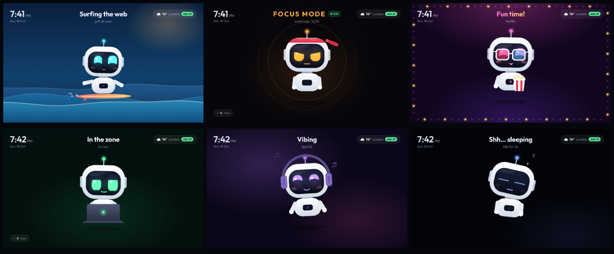

# andro-bot

Turn any spare Android tablet (or any device with a modern browser) into a live companion screen for your Mac:

- **A cute desk robot** that reacts to what you're doing: it surfs while you browse, puts on a headband
  for LeetCode, grabs popcorn for YouTube/Netflix, types along while you code, dances to your music,
  and falls asleep when you walk away.
- **A media panel** for whatever is playing on the Mac (YouTube in a browser, Spotify, Apple Music…)
  with artwork, a seek bar, play/pause/skip, volume, and an animated equalizer (optionally driven by the Mac's real audio).
- **A clock** with local weather, air quality and your next calendar event.

Everything runs on your own network. Nothing to install on the tablet; it's a web app.



## Requirements

| Side | Needs |
|---|---|
| Mac | macOS 14+ (tested on macOS 26), Xcode Command Line Tools (`xcode-select --install`), Homebrew, `/usr/bin/python3` |
| Tablet | Any recent Chrome / Android browser on the **same Wi‑Fi** as the Mac |

## Setup

```sh
git clone https://github.com/Sumit063/andro-bot.git
cd andro-bot

brew install media-control        # reads & controls macOS "Now Playing"
./helper/build.sh                 # compiles the Swift sensor helper → bin/cc-helper
cp config.example.json config.json   # then edit name, location, rules
./start.sh                        # prints the URL to open on the tablet
```

On the tablet, open the printed URL (e.g. `http://192.168.1.20:8765`) in Chrome and tap once to go
full screen. Optional: Android Developer Options → **Stay awake** (while charging) keeps the screen on.

### macOS permissions (one-time)

When you run `./start.sh` from Terminal, macOS attributes these to Terminal. Each is optional, and
the feature quietly degrades without it (the tablet's dock shows a hint for anything missing).

| Permission (System Settings → Privacy & Security) | Unlocks |
|---|---|
| Screen & System Audio Recording → Terminal | Only if you set `"liveAudio": true` (see below) |
| Automation → Terminal → Google Chrome / Safari | Site-based reactions (LeetCode, Netflix, …) |
| Input Monitoring → Terminal | Typing reactions (counts key presses only, never which key) |
| Calendars | Next event on the clock |

### Run at login (optional)

```sh
./install-autostart.sh          # installs a launchd agent; logs in logs/hub.log
./install-autostart.sh remove   # uninstall
```

Under launchd macOS asks for the permissions again for `python3` / `cc-helper` themselves.

## Configuration (`config.json`)

Changes are picked up within 2 seconds, no restart needed.

```jsonc
{
  "name": "friend",                                   // used in greetings
  "location": { "name": "London", "lat": 51.5, "lon": -0.13 },  // weather + AQI (Open-Meteo, no key)
  "clock24": false,
  "calendar": true,
  "liveAudio": false,                                 // real-audio equalizer (see note below)
  "idle": { "bored": 90, "sleep": 300 },              // seconds
  "rules": [                                          // first match wins
    { "sites": ["leetcode.com"], "scene": "focus", "label": "LeetCode" },
    { "urls": ["amazon.com/gp/video"], "scene": "funtime", "label": "Prime Video" },
    { "apps": ["Cursor", "Terminal"], "scene": "code" }
  ]
}
```

- `sites` match the hostname or any subdomain; `urls` match a substring of the full URL; `apps` match
  the macOS app name or bundle id.
- **Scenes:** `focus`, `funtime`, `surf`, `code`, `music`, `chat`, `default`. Sleep, bored, CPU-stress,
  low-battery and Claude Code states are layered on automatically.
- Optional `"dpr": 1` lowers canvas resolution on very slow tablets.
- **`liveAudio`** (default `false`): captures system audio through ScreenCaptureKit so the equalizer
  and the bot's dancing follow the real sound. macOS treats this as screen recording: it shows the
  recording indicator, and DRM video (Netflix, Prime Video, Disney+/Hotstar…) plays black while it's on.
  With it off, the equalizer animates on its own while something plays and media controls work the same.

## Using it

- **Tap** anywhere → dock: *Auto · Bot · Clock · Media* (Auto switches by itself) plus the live latency.
- **Swipe** left/right → switch view.
- **Tap the bot** → it giggles; tap 4× fast → it spins.
- **Tap the equalizer** → cycle bars / wave / ring.
- **Preview any scene** without switching apps: `http://<mac-ip>:8765/?demo=focus`
  (`surf`, `funtime`, `code`, `music`, `chat`, `sleep`, `media`).

### Claude Code integration (optional)

The bot shows a thinking bubble while Claude Code works and celebrates when it finishes. Add to
`~/.claude/settings.json`:

```json
{
  "hooks": {
    "UserPromptSubmit": [{ "hooks": [{ "type": "command", "command": "curl -s -m 1 'http://127.0.0.1:8765/api/event?e=thinking' >/dev/null 2>&1 || true" }] }],
    "Stop":             [{ "hooks": [{ "type": "command", "command": "curl -s -m 1 'http://127.0.0.1:8765/api/event?e=done' >/dev/null 2>&1 || true" }] }],
    "Notification":     [{ "hooks": [{ "type": "command", "command": "curl -s -m 1 'http://127.0.0.1:8765/api/event?e=attention' >/dev/null 2>&1 || true" }] }]
  }
}
```

Any other tool can drive the same states with `GET /api/event?e=thinking|done|attention|idle`.

## Project layout

```
server.py            Mac hub: HTTP + WebSocket server, state, rules, media commands (stdlib only)
helper/main.swift    Sensor helper: events · audio spectrum · calendar  (built to bin/cc-helper)
web/                 Tablet app: app.js (state/UI), bot.js (robot renderer), viz.js (equalizer)
config.example.json  Default settings & site/app rules
docs/                Architecture notes
```

See **[docs/architecture.md](docs/architecture.md)** for how it all fits together.

## Troubleshooting

- **Tablet stuck on "Connecting to your Mac…"** → same Wi‑Fi? Allow incoming connections for Python
  in the macOS firewall; check the IP printed by `start.sh`.
- **No media info** → `media-control test` must exit 0; something must be playing.
- **Want the equalizer to follow real audio?** → set `"liveAudio": true` and grant Screen & System Audio Recording.
- **Netflix/Prime shows a black screen or a "screen is being recorded" icon** → set `"liveAudio": false`.
- **Site reactions not working** → allow Automation for your browser; Firefox isn't scriptable.
- **Mac IP changes** → reserve a DHCP address for the Mac in your router.

## Security note

The hub listens on your LAN without authentication: anyone on the same network can open the page
and control playback/volume. Fine for a home network; don't run it on untrusted Wi‑Fi.

## Credits

- Font: [Outfit](https://fonts.google.com/specimen/Outfit) (SIL Open Font License 1.1)
- Weather & air quality: [Open-Meteo](https://open-meteo.com) (free, no API key)
- Now Playing access: [media-control](https://github.com/ungive/media-control)
